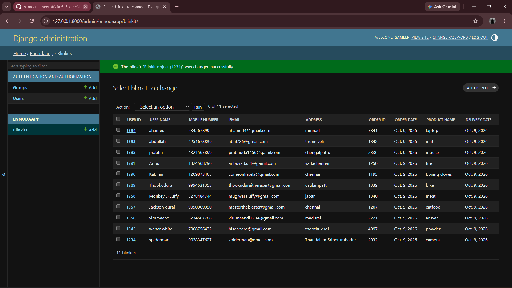

# Ex02 Django ORM Web Application
## Date:0910.2026 

## AIM
To develop a Django Application to store and retrieve data from a Vehicle Service Database platform using Object Relational Mapping(ORM).


## DESIGN STEPS

### STEP 1:
Clone the problem from GitHub

### STEP 2:
Create a new app in Django project

### STEP 3:
Enter the code for admin.py and models.py

### STEP 4:
Detect changes and create migration files that describe how to modify the database schema

### STEP 5:
Execute the migration files and update the database schema to match your Django models

### STEP 6:
Create a superuser with full access rights to all models and data through the admin interface.

### STEP 7:
Apply the migration files of the created app to the database

### STEP 8:
Execute Django admin using localhost and create details for 10 entries

## PROGRAM
```
models.py
from django.db import models
from django.contrib import admin
class Blinkit(models.Model):
    User_Id = models.IntegerField(primary_key=True)
    User_Name = models.CharField(max_length=100)
    Mobile_Number = models.IntegerField(max_length=10)
    Email = models.EmailField()
    Address = models.TextField()
    Order_Id = models.IntegerField()
    Order_Date = models.DateField()
    Product_Name = models.CharField(max_length=100)
    Delivery_Date = models.DateField()
class BlinkitAdmin(admin.ModelAdmin):
    list_display=["User_Id","User_Name","Mobile_Number","Email","Address","Order_Id","Order_Date","Product_Name","Delivery_Date"]


admin.py
from django.contrib import admin
from .models import Blinkit,BlinkitAdmin
admin.site.register(Blinkit,BlinkitAdmin)
```


## OUTPUT



## RESULT
Thus the program for creating Online Food Delivery Database using ORM hass been executed successfully
